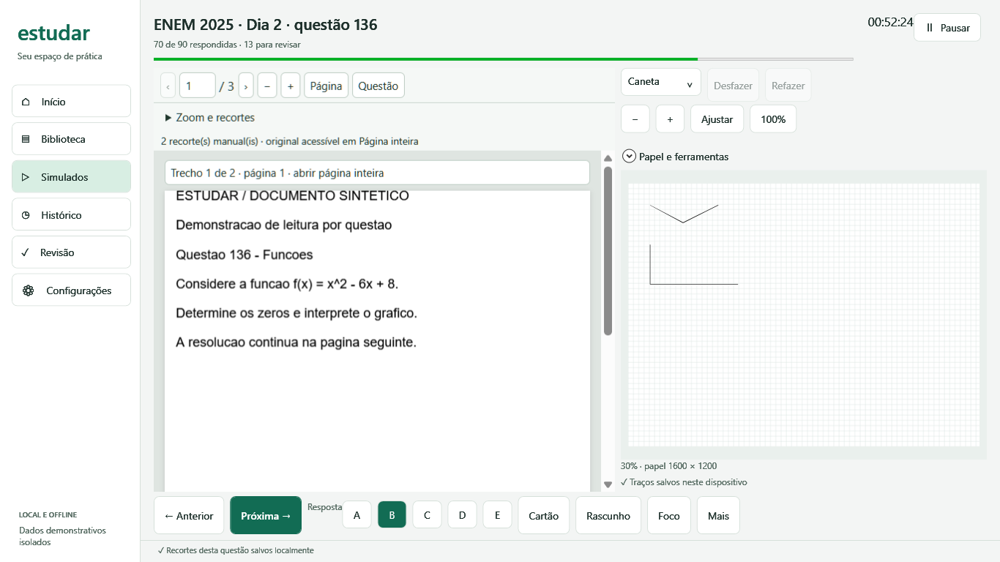
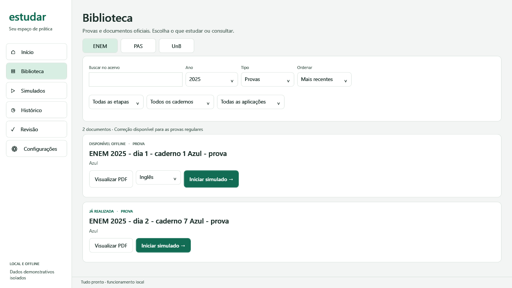
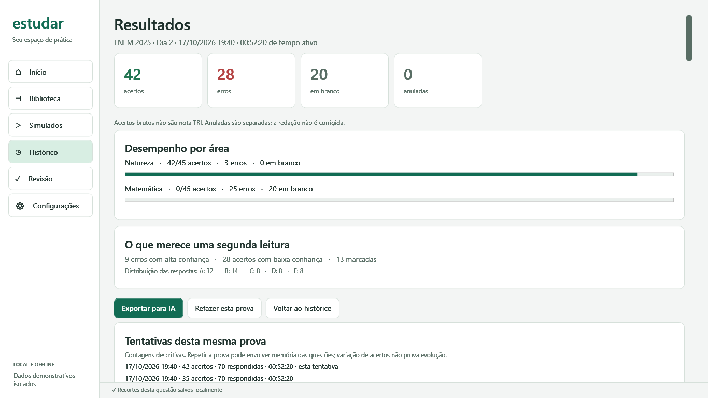

<div align="center">

# Estudar

**Provas oficiais, resolução e revisão no seu computador.**

Um aplicativo Windows para praticar ENEM e consultar o acervo do PAS e da UnB, com rascunho digital por questão e registros locais.

[](https://github.com/LuisAlves10/Estudar/actions/workflows/build.yml)

[](LICENSE)

[Baixar versão compilada](https://github.com/LuisAlves10/Estudar/releases) · [Compilar](#compilar) · [Limitações](#limitações)

</div>



<sub>Interface real com dados e documento sintéticos de demonstração. As funcionalidades descritas correspondem à branch `main`; a release estável pode ser anterior a estas melhorias.</sub>

## Para estudar

| Recurso | Como funciona |
|---|---|
| Biblioteca oficial | ENEM, PAS e UnB com busca, filtros, referências e verificação SHA-256. |
| Simulados ENEM | Cronômetro de tempo ativo, pausa, retomada, confiança e cartão de respostas. |
| Leitura por questão | Página inicial do índice e recortes manuais com vários trechos ou páginas. O PDF integral fica acessível. |
| Papel digital | Caneta, marca-texto, borracha, cores, espessura, desfazer/refazer, zoom, expansão e janela destacável. Traços editáveis por questão. |
| Histórico e revisão | Correção por área, filtros de erros e marcações, anotações, rascunhos e comparação descritiva de tentativas. |
| Conteúdos | Classificação manual com vários assuntos por questão e relatório por disciplina ou assunto, com tamanho da amostra. |
| Exportação local | JSON e Markdown com fontes, respostas, tempo, classificações, regiões, notas e rascunhos em ISF/PNG. |

Sem conta ou envio automático de registros. Depois de baixar o acervo, o aplicativo funciona offline.

## Capturas

| Biblioteca | Resultados |
|---|---|
| [](docs/screenshots/biblioteca.png) | [](docs/screenshots/resultados.png) |

As capturas usam registros sintéticos isolados. Nenhuma resposta ou anotação pessoal está nestas imagens.

## Começar

1. Baixe o ZIP Windows x64 em [Releases](https://github.com/LuisAlves10/Estudar/releases) e extraia a pasta inteira.
2. Abra `Estudar.exe`. É necessário Windows 10/11 com [WebView2 Runtime](https://developer.microsoft.com/microsoft-edge/webview2/). O pacote independente inclui o runtime .NET.
3. Execute `baixar-provas.bat` para obter os documentos oficiais e abra a biblioteca.

O downloader verifica tamanho e SHA-256, ignora arquivos íntegros e preserva arquivos divergentes. Se interromper, execute novamente. Para baixar apenas uma edição:

```powershell
./scripts/Download-Corpus.ps1 -Exam ENEM -Year 2025
```

O catálogo contém 581 documentos únicos. Eles ficam em `Acervo/ENEM`, `Acervo/PAS` e `Acervo/UnB`. Alguns documentos antigos têm rótulos de versão adaptada ou gabarito preliminar: confira a identificação antes de usar. Nenhum PDF é distribuído no GitHub.

### Durante a resolução

- Use anterior/próxima ou o cartão para trocar de questão. `Ctrl + Alt + A–E` responde; `Ctrl + Alt + ←/→` navega.
- No leitor, abra **Zoom e recortes** e use **Definir recorte** permite desenhar uma região e salvá-la. Adicione trechos de outras páginas, ou use **Corrigir** para ajustar o selecionado. **Página inteira** recupera o contexto e a seleção de texto.
- No rascunho, **Ajustar** encaixa a largura; **100%** retorna ao zoom padrão; `Ctrl + roda` amplia. Arraste com **Mover** ou com o botão do meio. **Papel e ferramentas** reúne expansão e janela destacável.
- Classificar é opcional: abra **Conteúdos da questão** durante a resolução ou a revisão. É possível editar e associar vários assuntos.

O gabarito só é mostrado após finalizar. Respostas e notas originais ficam preservadas; observações após a correção são registradas separadamente.

### Seus arquivos

Os registros ficam em `Dados/Estudos`: SQLite, preferências, rascunhos e exportações. Para backup completo, feche o app e copie essa pasta. O botão de backup nas configurações copia somente o banco.

A atualização do esquema 1 para 2 faz backup automático do SQLite antes da migração. Não recria tentativas nem modifica PDFs. Os traços continuam em ISF; o PNG é uma imagem derivada para consulta e exportação.

## Compilar

Instale o SDK .NET 10 no Windows. Na raiz do repositório:

```powershell
dotnet build Estudo.Windows -c Release
dotnet run --project Estudo.Tests -c Release
powershell -NoProfile -File Estudo.Tests/Download.Tests.ps1
./Publicar.ps1 -SelfContained
```

O executável estará em `Executavel/Estudar.exe`. Para desenvolver, use `dotnet run --project Estudo.Windows`. Sem `-SelfContained`, a publicação depende do .NET Desktop Runtime instalado.

## Estrutura técnica

- **Estudo.Core:** catálogo, tentativas, correção, classificação, regiões de leitura, persistência e exportação.
- **Estudo.Windows:** WPF, InkCanvas e PDF.js local em WebView2.
- **Estudo.Tests:** testes de regras, migração, persistência, exportação, tinta e verificação da interface.
- **catalogo:** metadados oficiais e índice de questões, sem enunciados.

O banco é SQLite. Classificações e regiões pertencem à questão e ao hash do PDF, compartilhadas entre tentativas; respostas e rascunhos pertencem a cada tentativa. O layout legado de acervo junto de `Aplicativo` continua compatível.

## Limitações

- Windows é a plataforma suportada. Pressão da caneta depende da mesa, do driver e do suporte do Windows.
- O índice oficial identifica a página inicial; o enquadramento preciso exige recortes manuais. Não há identificação automática das regiões.
- Classificações são manuais, não informações oficiais. Questões sem classificação continuam funcionando normalmente.
- Relatórios mostram contagens e questões distintas. Percentuais ficam ocultos abaixo de cinco respostas ou cinco questões distintas; mesmo com amostras maiores, diferenças entre tentativas não comprovam evolução.
- ENEM tem correção objetiva estruturada para 2009–2025. Acertos brutos **não são nota TRI**. Redação, PAS e UnB não têm correção automática.
- Testes de layout em dimensões equivalentes a 125%/150% não substituem validação com monitor e mesa reais nessas escalas.

Código sob [licença MIT](LICENSE). Dependências e documentos mantêm suas próprias licenças; consulte [THIRD-PARTY-NOTICES.md](THIRD-PARTY-NOTICES.md).
